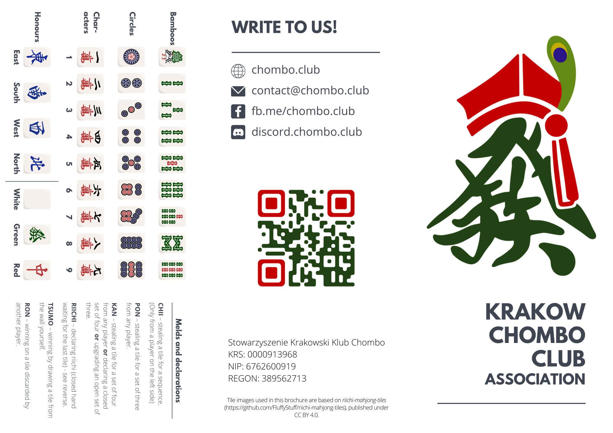
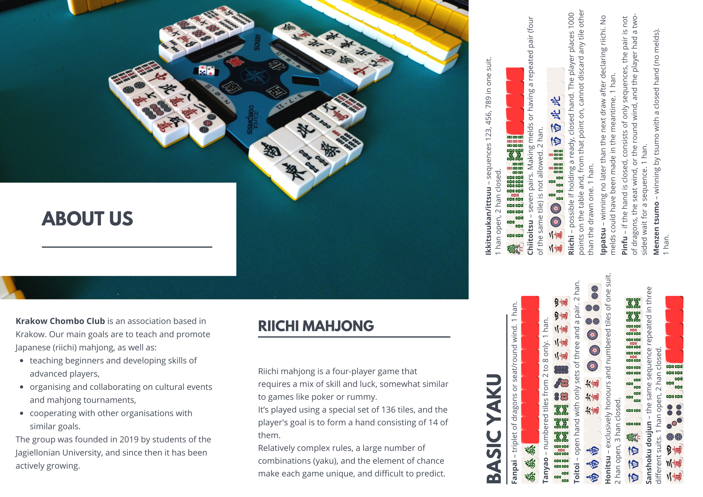

+++
title = "About"
path = "en/about"
template = "page.html"
+++

Kraków Chombo Club (KCC; pol. Krakowski Klub Chombo, KKC) is an association located in Kraków, Lesser Poland, Poland. Our primary focus is Riichi (Japanese) Mahjong in the Lesser Poland region: promoting the game, developing and improving skills of the players in the region as well as collaborating with other Mahjong associations. It has been created in 2019 by a group of students from Jagiellonian University and has grown ever since.

You can find us on the following social networking websites:
* [Discord]({{ <footer_link label="Discord" links={config.extra.footer_links} /> }}) — where all of our casual conversations take place
* [Facebook]({{ <footer_link label="Facebook" links={config.extra.footer_links} /> }}) — where we keep you informed about current and future events
* [Instagram]({{ <footer_link label="Instagram" links={config.extra.footer_links} /> }}) — where we publish photos from our events and meetings
* [X (formerly Twitter)]({{ <footer_link label="X" links={config.extra.footer_links} /> }}) — where we inform international community about our league and tournament competitions
* [GitHub]({{ <footer_link label="GitHub" links={config.extra.footer_links} /> }}) — where we keep the software we build to help improve Mahjong skills
* [YouTube]({{ <footer_link label="YouTube" links={config.extra.footer_links} /> }}) — where we publish our guides and other videos

## Association {#association}

### Donations {#donations}

If you would like to send a donation to support the Krakow Chombo Club Association, you can do that by making a bank transfer in the PLN or EUR currency to the following bank account:

**Recipient**: Stowarzyszenie Krakowski Klub Chombo\
**IBAN**: `PL71 1870 1045 2078 1088 3294 0001`\
**SWIFT/BIC**: `NESBPLPW`\
**Reference**:
```
Donation for the Association's statutory objectives
```

Any amount is welcome!

### Authorities of the Association {#authorities-of-the-association}

* Mateusz Maćkowski — President of the Board
* Aleksandra Malarz — Vice President of the Board
* Kosma Kotschmarów — Member of the Board
* Szymon Nowicz — Member of the Board
* Aleksander Orlikowski — Member of the Board
* Anna Szatan — Member of the Board
* Michał Tkaczyk — Member of the Board

### Audit Committee {#audit-committee}

* Rafał Burczyński — Chairman of the Audit Committee
* Konrad Górka — Member of the Audit Committee
* Marek Grzelak — Member of the Audit Committee

### Honorary Members {#honorary-members}

* Michał Herda

## Leaflet {#leaflet}





[Download the leaflet in the PDF format](/assets/download/leaflet-en.pdf)
