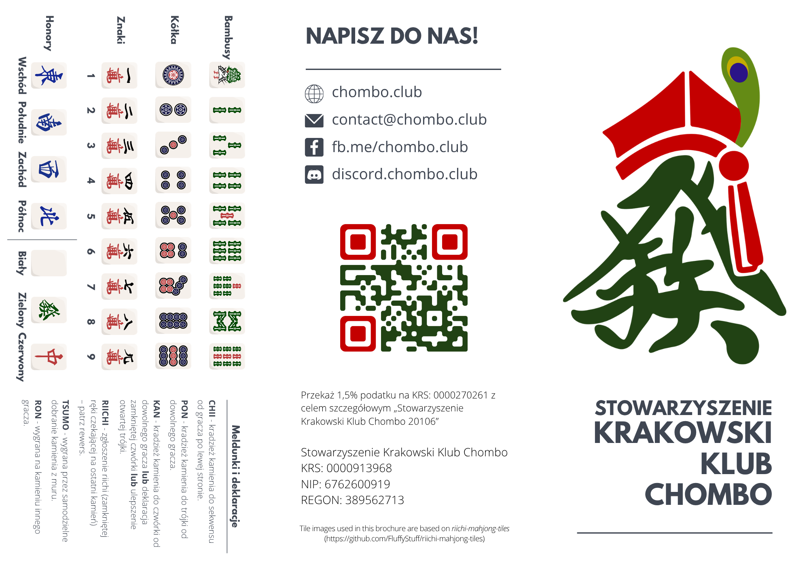
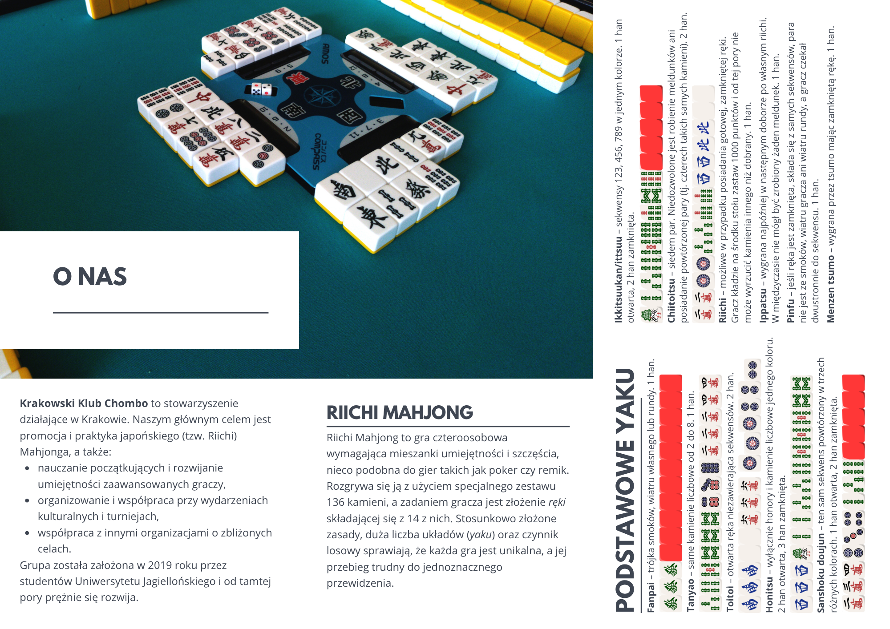

+++
title = "O nas"
path = "about"
template = "page.html"
+++

Krakowski Klub Chombo (KKC; ang. Krakow Chombo Club, KCC) to stowarzyszenie zlokalizowane w Krakowie. Naszym celem działania jest japoński (tzw. riichi) mahjong: promowanie gry na obszarze Małopolski, nauczanie początkujących i rozwijanie umiejętności zaawansowanych graczy oraz współpraca z innymi stowarzyszeniami o zbliżonych celach. Stowarzyszenie powstało w 2019 roku dzięki współpracy studentów Uniwersytetu Jagiellońskiego i rozrasta się od tamtego czasu.

Można nas znaleźć na poniższych sieciach społecznościowych:
* [Discord]({{ <footer_link label="Discord" links={config.extra.footer_links} /> }}) — gdzie prowadzimy codzienne rozmowy
* [Facebook]({{ <footer_link label="Facebook" links={config.extra.footer_links} /> }}) — gdzie informujemy o aktualnych i przyszłych wydarzeniach
* [Instagram]({{ <footer_link label="Instagram" links={config.extra.footer_links} /> }}) — gdzie publikujemy zdjęcia z naszych wydarzeń i spotkań
* [X (dawniej Twitter)]({{ <footer_link label="X" links={config.extra.footer_links} /> }}) — gdzie informujemy międzynarodową społeczność o naszych zmaganiach ligowych i na turniejach
* [GitHub]({{ <footer_link label="GitHub" links={config.extra.footer_links} /> }}) — gdzie budujemy oprogramowanie pomagające rozwinąć umiejętności w mahjongu
* [YouTube]({{ <footer_link label="YouTube" links={config.extra.footer_links} /> }}) — gdzie wrzucamy nasze poradniki i inne wideo

## Stowarzyszenie {#stowarzyszenie}

[Pobierz statut w formacie PDF](https://github.com/riichi/statute-pl/releases/download/release-2025-07-27/statut.pdf)

### Jak dołączyć? {#jak-dołączyć}

Zapraszamy wszystkich chętnych do zostania członkami Stowarzyszenia!
Zgodnie z §12 Statutu, w tym celu należy opłacić składkę, uzyskać rekomendację dwóch członków Stowarzyszenia oraz złożyć deklarację członkowską.
Deklaracja może być złożona w formie papierowej lub też podpisana [profilem zaufanym](https://www.gov.pl/web/profilzaufany) i wysłana pocztą elektroniczną na adres `zarzad@chombo.club`.
W razie wszelkich pytań/wątpliwości zachęcamy do kontaktu.

[Pobierz deklarację członkowską w formacie PDF](/assets/download/deklaracja_czlonkowska.pdf)

#### Dlaczego? {#dlaczego}

Dołączając do Stowarzyszenia Krakowski Klub Chombo:

* uzyskujesz możliwość wypożyczenia sprzętu Stowarzyszenia,
* możesz wziąć czynny i bierny udział w wyborach do władz Stowarzyszenia,
* otrzymujesz konto mailowe w domenie `@chombo.club` wraz z kontem w usłudze Google Workspace,
* otrzymujesz dostęp do kont premium w różnych serwisach internetowych (Canva Pro),
* dostajesz koszulkę klubową z własnym nazwiskiem,
* otrzymujesz możliwość uczestnictwa w wyjazdach klubowych,
* możesz się rozwinąć w ramach organizacji wydarzeń i aktywności Stowarzyszenia,
* otrzymujesz rangę członkowską oraz dostęp do dodatkowych kanałów na serwerze Discord Krakowskiego Klubu Chombo,
* wspierasz rozwój mahjonga w Małopolsce!

#### Składka członkowska {#składka-członkowska}

Przed dołączeniem do Stowarzyszenia należy uiścić składkę członkowską.
Składka zarówno za pierwsze, jak i drugie półrocze 2026 roku wynosi 30 PLN (zatem za cały rok jest to 60 PLN).
Pierwsza składka kandydata wstępującego w poczet członków Stowarzyszenia jest obniżona o 5 złotych za każdy pełny miesiąc, który upłynął od początku półrocza.

##### Dane do przelewu {#dane-do-przelewu}

**Odbiorca**: Stowarzyszenie Krakowski Klub Chombo \
**Numer konta**: `PL71 1870 1045 2078 1088 3294 0001` \
**Tytuł**:
```
{imię i nazwisko} - składka członkowska za I połowę 2026 roku
```

lub
```
{imię i nazwisko} - składka członkowska za II połowę 2026 roku
```

lub
```
{imię i nazwisko} - składka członkowska za 2026 rok
```

### 1,5% podatku {#15-podatku}

Dzięki współpracy z [Fundacją Studencką „Młodzi-Młodym”](https://fsmm.pl/) istnieje możliwość przekazania 1,5% podatku dochodowego na Stowarzyszenie Krakowski Klub Chombo.
W tym celu podczas wypełniania formularza PIT należy wpisać **KRS: 0000270261** z celem szczegółowym: **Stowarzyszenie Krakowski Klub Chombo 20106**.
Szczegóły akcji dostępne są na [stronie internetowej Fundacji MM](https://fsmm.pl/20106/zagraj_z_nami_w_mahjonga).

### Darowizna na cele statutowe {#darowizna-na-cele-statutowe}

Istnieje możliwość bezpośredniego wsparcia Stowarzyszenia poprzez przesłanie darowizny na cele statutowe.
Dane do przelewu:

**Odbiorca**: Stowarzyszenie Krakowski Klub Chombo \
**Numer konta**: `PL71 1870 1045 2078 1088 3294 0001` \
**Tytuł**:
```
Darowizna na cele statutowe Stowarzyszenia
```

Każda kwota jest mile widziana!

### Władze Stowarzyszenia {#władze-stowarzyszenia}

* Mateusz Maćkowski — Prezes Zarządu
* Aleksandra Malarz — Wiceprezes Zarządu
* Kosma Kotschmarów — Członek Zarządu
* Szymon Nowicz — Członek Zarządu
* Aleksander Orlikowski — Członek Zarządu
* Anna Szatan — Członek Zarządu
* Michał Tkaczyk — Członek Zarządu

### Komisja Rewizyjna {#komisja-rewizyjna}

* Rafał Burczyński — Przewodniczący Komisji Rewizyjnej
* Konrad Górka — Członek Komisji Rewizyjnej
* Marek Grzelak — Członek Komisji Rewizyjnej

### Członkowie Honorowi {#członkowie-honorowi}

* Michał Herda

## Ulotka {#ulotka}





[Pobierz ulotkę w formacie PDF](/assets/download/leaflet-pl.pdf)
