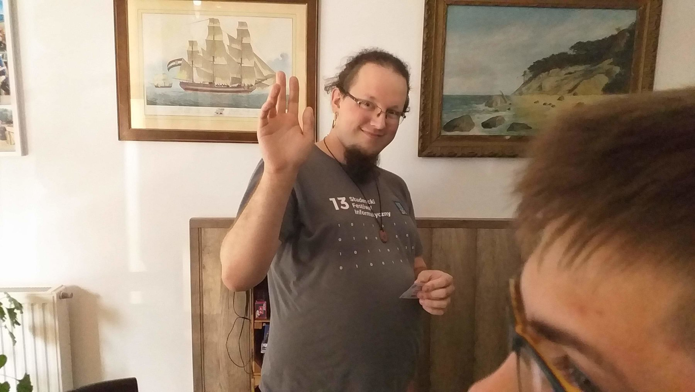

+++
title = "Michał Herda has become a USMA referee"
date = 2020-01-20T23:15:05+01:00
path = "en/other/2020/01/20/new-referee-michal-herda"
template = "post.html"

[taxonomies]
categories = ["other"]
+++

We are happy to announce that our colleague Michał Herda has become an [Upper Silesian Mahjong Association](https://mahjongsilesia.wordpress.com/referee/)-certified referee. He is now eligible for refereeing USMA ranked games as well as non-MERS (USMA) tournaments. Congratulations!

