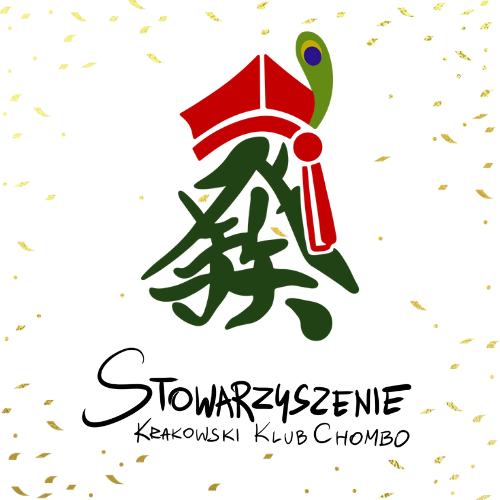

+++
title = "Stowarzyszenie Krakowski Klub Chombo"
date = 2021-08-09T22:00:00+01:00
path = "other/2021/08/09/kcc-association"
template = "post.html"

[taxonomies]
categories = ["other"]
+++

Stało się — z dniem 29 lipca 2021 roku Krakowski Klub Chombo stał się oficjalnie stowarzyszeniem. Jest to zwieńczenie niemal dwuletniego procesu — jednego roku wspólnej gry i planów na przyszłość, oraz kolejnego, który poświęciliśmy na proces formalny i rozwój idei stowarzyszenia. Mamy nadzieję, że oficjalna forma stowarzyszenia pozwoli nam na organizowanie lepszych wydarzeń, a członkom klubu na łatwiejsze reprezentowanie regionu na arenie krajowej i międzynarodowej. Nie spoczywamy na laurach — już planujemy pierwsze duże wydarzenie jako stowarzyszenie, czyli krakowski turniej, który najprawdopodobniej odbędzie się w ostatnim kwartale tego roku!

Zainteresowanych członkostwem w Stowarzyszeniu albo jego działaniach zachęcamy do kontaktu przez naszego [fanpage’a na Facebooku](https://fb.me/chombo.club) lub [Discorda](https://discord.chombo.club).
