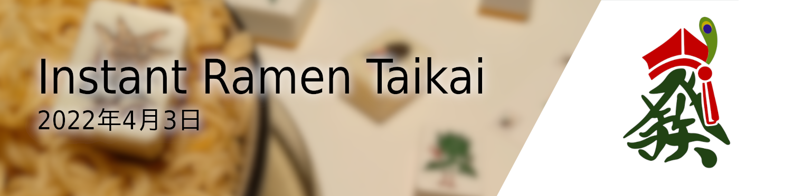
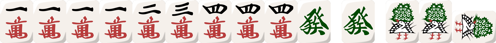
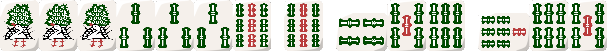
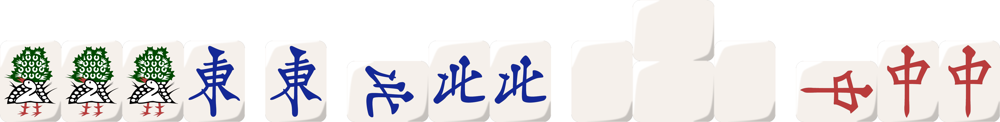
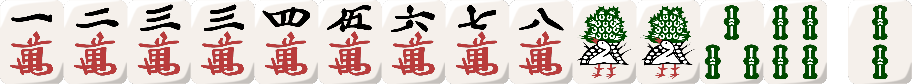
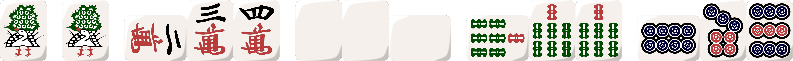
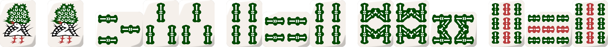

+++
title = "Instant Ramen Taikai 2022"
date = 2022-02-15T14:00:00+01:00
path = "tournaments/2022/02/15/instant-ramen-taikai"
template = "post.html"

[taxonomies]
categories = ["tournaments"]
+++

Czas na pierwszy krakowski turniej riichi o smaku kurczaka! Turniej odbędzie się 3 kwietnia 2022 roku
w kawiarni [Boardowa](http://boardowa.pl/) i będzie rozgrywany na zmodyfikowanych
zasadach [EMA](http://mahjong-europe.org/). Dodatkowo, turniej będzie uwzględniony w rankingu
[Górnośląskiego Związku Madżonga](https://mahjongsilesia.wordpress.com/).

Poniżej znajdziecie wszystkie szczegóły dotyczące turnieju oraz link do
formularza rejestracyjnego. Zgłoszenia przyjmujemy do 20 marca, ale prosimy o
jak najszybsze wpisywanie się, żebyśmy mogli oszacować liczbę uczestników.

Każdy przy rejestracji dostaje kubek instant ramen do samodzielnego zalania + wielorazowe pamiątkowe pałki do jedzenia. ❤️

## O turnieju {#o-turnieju}

* Data: 3 kwietnia 2022 (niedziela)
* Miejsce: [Boardowa, ul. Topolowa 52, 31-506 Kraków](https://g.page/Boardowa)
* Zasady: **modyfikowane** EMA 2016; uma +15/+5/-5/-15; bez oki
* Hanchany: 4
* Sędziowie: Michał Herda (nie będzie grał)
* Substytuci: TBA
* Opłata: 45zł (30zł do wykorzystania na barze w Boardowej)
* Limit osób: 24
* Punktacja: [Mahjong Tracker](https://mahjongtracker.com/)

## Zasady {#zasady}

Zasady to **EMA 2016 z następującymi modyfikacjami:**

### Honorowy ptak {#honorowy-ptak}
1s liczy się jako jedynka souzu *lub* aktywny honor w zależności od tego, co da więcej punktów. To oznacza, że:

* Para z 1s może dać 2 fu za parę z aktywnego honoru (blokuje wtedy pinfu!);
* 1s nie jest ani smokiem, ani wiatrem, więc nie może zastąpić żadnego w shousangen/daisangen lub shousuushii/daisuushii;
* Koutsu albo kantsu z 1s może liczyć się jako **fanpai kura** (patrz niżej).

### Dodatkowe yaku: fanpai kura (蔵) {#dodatkowe-yaku-fanpai-kura-蔵}
* Koutsu albo kantsu z 1s traktowanych jako honory.
* Możliwa wygrana przez tsumo albo ron.
* Warte 1 han.

### Dodatkowe yaku: kinkei dokuritsu (金鶏独立) {#dodatkowe-yaku-kinkei-dokuritsu-金鶏独立}
* Cztery zameldowane grupy + pojedyncze czekanie (hadaka tanki) na 1s.
* Możliwa wygrana przez tsumo albo ron.
* Zawsze warte 5 han (mangan), nie łączy się z innymi yaku (ale łączy się z dorami).

### Yakitori {#yakitori}

* Kara za niewygranie żadnej ręki w całym hanchanie.
* Warte -10000 punktów, liczone przed umą.

### Przykłady {#przykłady}

Ręka powyżej to honitsu w manach + fanpai kura.

Ta ręka nie korzysta z zasady honorowego ptaka, bo wtedy byłoby tylko honitsu + kura;
zamiast tego ręka to "zwyczajne" chinitsu w souzu.

Ta ręka to yakuman tsuuiisou.

Jeśli policzymy parę z 1s jako parę z honorów, to dostajemy 2 fu.
Lepiej jest potraktować ją jako parę ze zwykłych kamieni, co daje nam pinfu.

To jest po prostu kinkei dokuritsu, warty mangana - ignorujemy białego smoka.

Jesli liczymy kinkei dokuritsu, to ta ręka to tylko mangan.
Zamiast tego powinniśmy policzyć tu chinitsu toitoi, warty hanemana.

## Agenda {#agenda}

| Godzina       | Etap                |
|---------------|---------------------|
| 09:00 - 09:30 | Rejestracja         |
| 09:30 - 09:45 | Otwarcie turnieju   |
| 09:45 - 11:00 | 1. hanchan          |
| 11:30 - 12:45 | 2. hanchan          |
| 12:45 - 14:30 | Przerwa obiadowa    |
| 14:30 - 15:45 | 3. hanchan          |
| 16:15 - 17:30 | 4. hanchan          |
| 17:45 - 18:00 | Zamknięcie turnieju |

{#
## Lista uczestników

| Imię       | Nazwisko   | Pseudonim  | Miasto           |
|------------|------------|------------|------------------|
#}

## Rejestracja {#rejestracja}

[Tutaj!](https://forms.gle/cDMZcCej329RFSti8)
