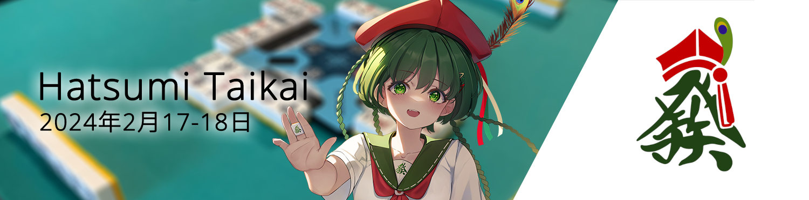
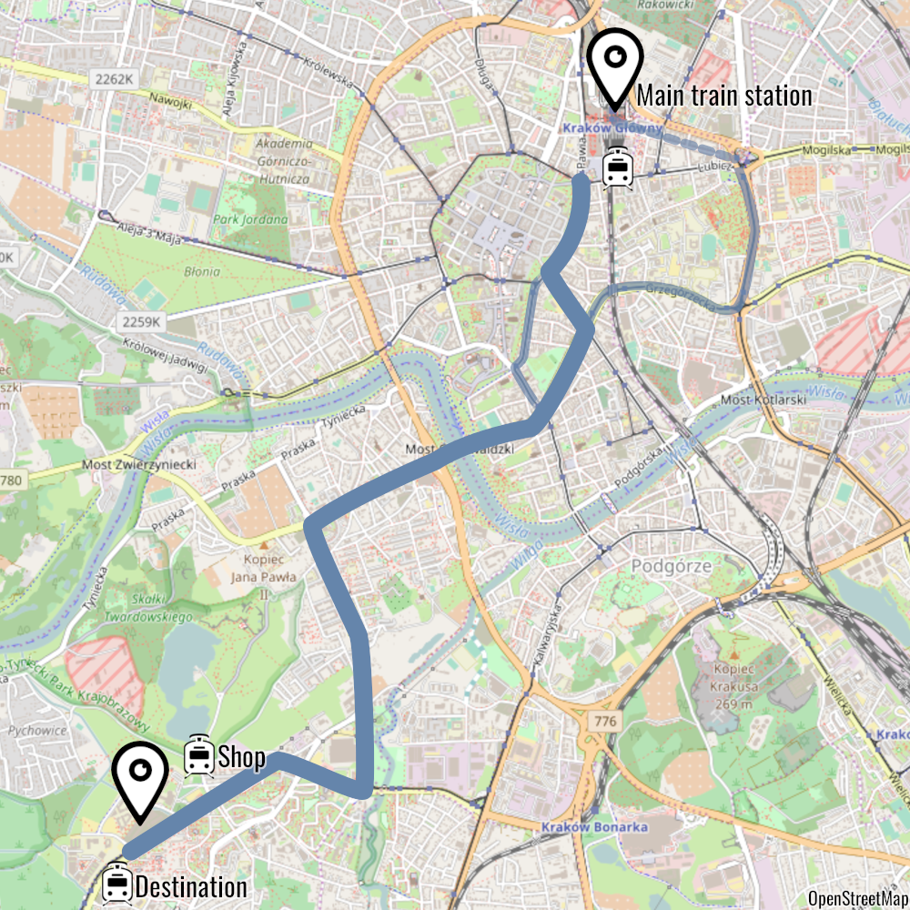

+++
title = "Hatsumi Taikai"
date = 2023-10-06T16:00:00+02:00
updated = 2024-02-17T15:37:13+01:00
path = "tournaments/2023/10/06/hatsumi-taikai"
template = "post.html"

[taxonomies]
categories = ["tournaments"]
+++

Zapraszamy Was na drugi turniej MERS w Krakowie!

## O turnieju {#o-turnieju}

* Data: 17-18 lutego 2024 (sobota-niedziela)
* Miejsce: [Wydział Matematyki i Informatyki UJ, prof. Stanisława Łojasiewicza 6, 30-348 Kraków](https://goo.gl/maps/izBiryMK8gM9GpQd6)
* Zasady: EMA Riichi 2016
* Hanchany: 8
* Wpisowe: 150 PLN (35 EUR)
* Limit osób: 84
* Obserwator EMA: Michael Gürtl-Dusleag
* Sędziowie:
  - Michał Herda
  - Mateusz Maćkowski
  - Fabien Sacha
  - Szymon Nowicz (sędzia grający)
* Obiad: wliczony w cenę wpisowego
* Nagrody: trofea dla pierwszych trzech miejsc, gadżety klubowe dla pierwszych 10 miejsc

Punkty będą śledzone za pomocą mobilnej aplikacji [Mahjong Tracker](https://mahjongtracker.com/) - polecamy zapoznać się
z jej działaniem przed turniejem.

Z reprezentantami **8** krajów EMA i łączną liczbą **84** graczy, aktualny ranking turnieju MERS wynosi **3.5** (maksimum to 4.0).\
<small>Statystyka ta aktualizuje się automatycznie. Szczegóły dotyczące sposobu obliczania wagi można znaleźć [na stronie EMA](http://mahjong-europe.org/ranking/Basicsranking.html).</small>

## Agenda {#agenda}

<table class="tournament-agenda">
<tbody>
  <tr><th colspan="2" scope="colgroup">Sobota, 17 lutego</th></tr>
  <tr>
    <td>09:00-09:45</td>
    <td>Rejestracja</td>
  </tr>
  <tr>
    <td>09:45-10:00</td>
    <td>Otwarcie turnieju</td>
  </tr>
  <tr>
    <td>10:00-11:30</td>
    <td>1. hanchan</td>
  </tr>
  <tr>
    <td>11:50-13:20</td>
    <td>2. hanchan</td>
  </tr>
  <tr>
    <td>13:20-14:45</td>
    <td>Przerwa obiadowa</td>
  </tr>
  <tr>
    <td>14:45-16:15</td>
    <td>3. hanchan</td>
  </tr>
  <tr>
    <td>16:35-18:05</td>
    <td>4. hanchan</td>
  </tr>
  <tr>
    <td>19:00-24:00</td>
    <td>Afterparty — <a href="https://maps.app.goo.gl/rxV5KY1KKB24t9bVA">T.E.A. Time Brewpub</a></td>
  </tr>
</tbody>
<tbody>
  <tr><th colspan="2" scope="colgroup">Niedziela, 18 lutego</th></tr>
  <tr>
    <td>09:00-10:30</td>
    <td>5. hanchan</td>
  </tr>
  <tr>
    <td>10:50-12:20</td>
    <td>6. hanchan</td>
  </tr>
  <tr>
    <td>12:20-13:15</td>
    <td>Przerwa obiadowa</td>
  </tr>
  <tr>
    <td>13:15-14:45</td>
    <td>7. hanchan</td>
  </tr>
  <tr>
    <td>15:05-16:35</td>
    <td>8. hanchan</td>
  </tr>
  <tr>
    <td>16:45-17:15</td>
    <td>Ogłoszenie wyników i zamknięcie</td>
  </tr>
</tbody>
</table>

## Dojazd {#dojazd}

Na miejsce turnieju polecamy wybrać się tramwajem lub autobusem &mdash;
najbliższy przystanek to **Ruczaj**, przykładowe
połączenia tramwajowe z Dworca Głównego (przystanek **Teatr Słowackiego**):
* 52, ok. 22 minuty,
* 3 &#8594; 18, ok. 22 minuty ale wymaga przesiadki,
* 50 &#8594; 17, ok. 32 minuty ze względu na okrężną trasę.

Dojście z przystanku wymaga ok. pięciominutowego spaceru na Wydział Matematyki i
Informatyki Uniwersytetu Jagiellońskiego.

Niedaleko Wydziału (ok. 5 minut spacerem) znajduje się sklep Kaufland &mdash;
można do niego wstąpić po drodze wysiadając przystanek wcześniej, na przystanku
**Norymberska**.
Warto pamiętać, że w niedzielę 18 lutego będzie on zamknięty.

Na terenie turnieju jest również dostępny bezpłatny parking.

Wskazówki dojścia na teren turnieju z przystanków komunikacji miejskiej:

<iframe title="Mapa dojazdu" loading="lazy" src="https://www.google.com/maps/d/embed?mid=18YtUK4g1d6xtpzogBGiCnxFl_bbd_LI&ehbc=2E312F&noprof=1" style="width: 100%; height: 480px;"></iframe>

Szczegółowe instrukcje dojazdu można uzyskać korzystając z
<https://krakow.jakdojade.pl> lub <https://maps.google.com>.

## Rejestracja {#rejestracja}

**UWAGA:** Obecnie lista zawodników jest pełna &mdash; nadal jednak można zapisać się na listę oczekujących i wziąć udział w turnieju, jeśli któryś z zarejestrowanych graczy zrezygnuje.

**[Zapisy na turniej](https://forms.gle/Q9MxGdNQU1fJbf746)**

**UWAGA:** Rejestracja zostanie zamknięta 31 stycznia &mdash; jest to ostatni dzień na wysłanie ważnego zgłoszenia.

{#
## Gracze

<small>Ostatnia aktualizacja: {{ page.updated | date(format="%Y-%m-%d %H:%M", timezone=config.extra.timezone) }}</small>

	

		84/84
	

| Nr | Imię i nazwisko                          | Pseudonim            | Kraj                 | EMA ID                                                              |                       Wpisowe                        |
|---:|:-----------------------------------------|:---------------------|:---------------------|:--------------------------------------------------------------------|:----------------------------------------------------:|

### Lista oczekujących

Gracze będą przeniesieni z listy oczekujących jeżeli któryś z zapisanych uczestników zrezygnuje z udziału. Będzie to robione w kolejności zgłoszeń.

| Nr | Imię i nazwisko                          | Pseudonim            | Kraj                 | EMA ID                                                              |
|---:|:-----------------------------------------|:---------------------|:---------------------|:--------------------------------------------------------------------|

#}
